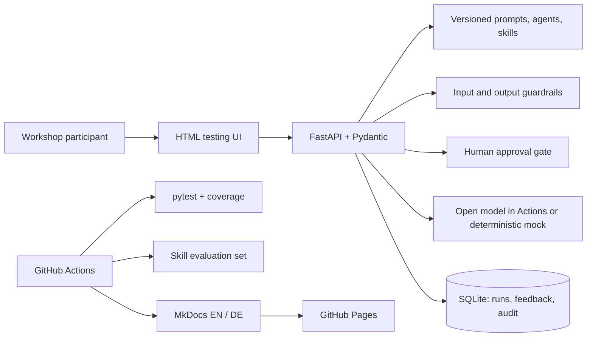

# Internal AI Platform Lab

A small, fictional-company platform for experimenting with prompts, agents, reusable skills, safety checks, and human feedback. **All four departments and every example or data point in this repository are invented.** Do not submit real company, personal, customer, confidential, or regulated data.

The project is designed to build, test, evaluate, and publish from GitHub Actions. It has no Docker requirement and no API keys. The service uses a deterministic mock by default; Actions also attempts the small open `sshleifer/tiny-gpt2` model, with automatic mock fallback if it cannot initialize. GitHub Pages publishes the bilingual MkDocs training site from `main`.

## Architecture

The approval endpoint records a reviewer decision only; it does not execute an external action. The demo is not a hosted production service. GitHub Actions runs CI and the model smoke test; Pages hosts static training documentation.

## Contents

- `platform_app/`: FastAPI app, browser UI, SQLite persistence, library registry, mock/model adapters, allow-listed demo tools, and guardrails.
- `library/skills/`: Four reusable skill folders, each with instructions and examples.
- `requirements/request-template.md`: Department request intake and a worked request → skill → test example.
- `evals/skills.json`: Small per-skill rubric scorecard (3/3 illustrative baseline criteria per skill).
- `tests/`: Library, skills, agent tools, guardrail, API, feedback, approval, and audit tests.
- `docs/en/` and `docs/de/`: User guide, prompt guide, application examples, responsible AI policy, and workshop agenda with Markdown slides.
- `.github/workflows/quality.yml`: Python 3.12 checks, coverage artifact, open-model smoke attempt, strict MkDocs build, and GitHub Pages deployment.

## Design decisions

1. **HTML instead of a frontend build tool:** keeps the test UI small and lets FastAPI serve it without a Node toolchain.
2. **SQLite:** easy to create in an ephemeral Actions runner, with clear tables for runs, ratings, and audit events.
3. **No raw inputs in the run table:** retain a SHA-256 digest for correlation and store the generated response for review. Demo output and feedback may still be sensitive.
4. **Mock first, model optional:** deterministic behavior keeps API tests repeatable; a tiny open model is attempted in a separate Actions job, with graceful fallback.
5. **Tools are allow-listed and fictional:** three agents invoke read-only or draft-only stubs; there are no connected systems or side effects.
6. **Guardrails are explicit patterns:** simple checks are understandable for training, but can miss or over-match data and are not a security boundary.
7. **Human approval pauses consequential intent:** the approval record is an audit event, never permission to perform a real-world action.
8. **Examples are invented end-to-end:** sales, product development, customer service, and marketing exist only as fictional examples in this lab.

## Automated workflows

`Quality and docs` runs on pushes, pull requests, and manual workflow dispatch. It installs Python 3.12, runs pytest with a coverage threshold and uploads `coverage.xml`, attempts the tiny open model with mock fallback, and builds MkDocs in strict mode. On pushes to `main`, a Pages job publishes the site using the GitHub Pages Actions deployment.

The API and interactive UI are workflow-tested components, not a continuously hosted API. The Pages site is static training content. This meets the Actions-only constraint without a local Docker setup, API key, or external AI account.

## Roadmap

- Add a privacy-preserving retention policy and configurable SQLite cleanup.
- Add reviewed, department-owned prompt change requests and semantic version history.
- Expand evaluation cases with blinded human ratings and regression comparisons.
- Add accessible UI localization and skill search/filtering.
- Add role-based approval identity and signed audit export before any real deployment.
- Explore retrieval from approved, synthetic-only knowledge sources.
- Add model card review, latency/cost reporting, and stronger adversarial input tests.

## Training

Start with the [English guide](docs/en/guide.md), [German guide](docs/de/guide.md), or `docs/en/workshop.md` and `docs/de/workshop.md`. The complete testable service contract is exposed by FastAPI's OpenAPI docs at `/docs` when the API is running in its Actions job.
